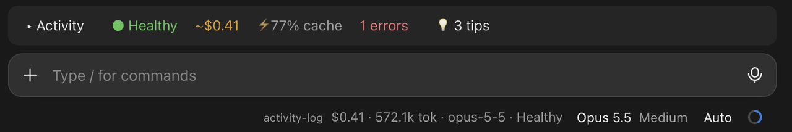
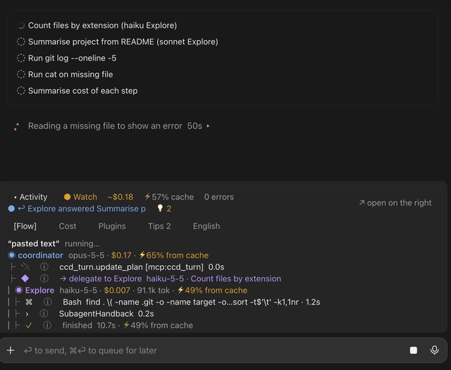
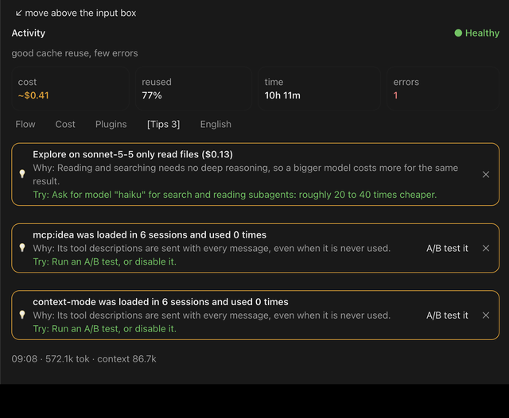
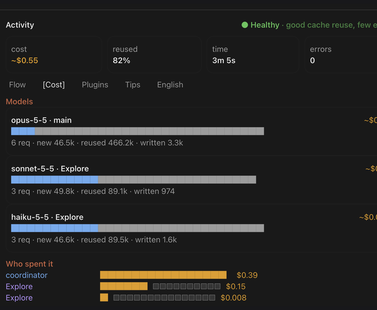
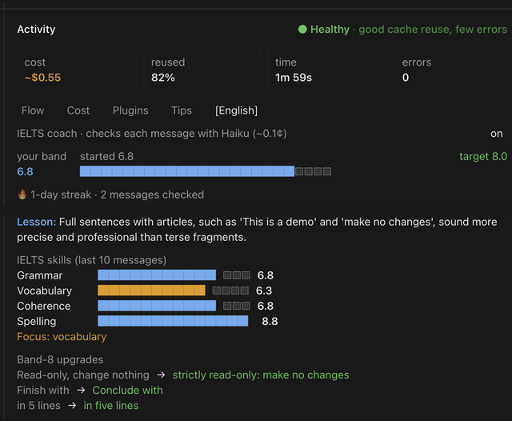

# claude-activity-panel

A live **Activity** panel for Claude Code. It shows what Claude, its subagents, skills and plugins are doing, what it costs, how much of the input came from cache, and gives tips. It also includes an optional English coach.

## Screenshots

Real screenshots from the Claude desktop app. The English one is cropped to leave out the text of a message.

**The dock above the input, closed** (plus the status line under the input)

<p align="center"></p>

**Opened**

<p align="center">
  
  
</p>
<p align="center"><sub>Flow · Tips</sub></p>
<p align="center">
  
  
</p>
<p align="center"><sub>Cost · English coach</sub></p>

## Features

- **Live Flow:** each turn is titled with your own words, and shows the coordinator's steps, each subagent's own steps nested under its hand-off, cache % and cost per step, errors with their reason, and the step running now.
- **Hints (ⓘ):** a plain-language explanation of each command or tool. Common commands are built in. For unknown ones, Haiku explains them (about 0.05¢ each). MCP tools show their own description.
- **Cost:** model cards with new, reused and written tokens; who spent what; and what each source added to the context.
- **Plugins:** uses across your last 20 sessions, an **A/B test** to see whether a plugin is worth its tokens, and a list of all installed plugins with turn on / turn off buttons.
- **Tips:** each tip says what happened, why it costs you, and what to try. Covers low cache reuse, subagents on a big model that only read files, re-read files, repeated errors, a large context, and unused plugins.
- **Model routing:** adds a short section to Claude's system prompt: picks a model (Haiku, Sonnet or Opus) and an effort level (low to max) for each subagent by the kind of work. The default is written to `~/.claude/activity-panel/model-routing.md` on first run; edit that file to change the rules (it is read again every turn), or empty it to turn routing off. `/model-routing` shows the current text.
- **Settings tab:** a menu on the right with two pages. **System prompt** lets you edit the model routing text (Enter saves, **reset to default** brings back the default) and browse every section of the system prompt Claude last received, which is also saved to `~/.claude/activity-panel/last-system-prompt.md`. **Version history** lists what each release of the panel changed, one short line per change. Watch the Cost tab to see the saving.
- **Dock:** a one-line bar above the input that opens to the full panel. You can move the panel to the right side.
- **English coach (optional):** checks only what you type, not pasted text. It gives a corrected version, the fixes, a lesson, a better prompt you can use, practice cards from your own mistakes, and band per week. Turn it off in the English tab.

## Install

In a terminal session:

```
/plugin marketplace add miladSorour/claude-activity-panel

/plugin install activity-log@miladsorour-plugins
```

Choose the user scope when asked. The panel then opens in every session.

## Reopen the panel

Closed the panel? Type either command in the prompt box:

```
/activity-log
/activity
```

Both open the panel on the right, or open and fold it when it sits above the input box. When the panel is on the right and closed, you can also click **▸ open Activity panel** above the input box.

## Requirements

Claude Code **2.1.309 or newer**. The panel uses mod APIs that older versions don't have (text fields, `prompt.compose`), and older versions refuse to load it.

## Update

### 1. Update Claude Code

- **Desktop app:** it updates itself; restart the app to apply a downloaded update.
- **Terminal (`claude` CLI):**

  ```bash
  claude --version
  claude update
  ```

  If `claude --version` shows an older version than the desktop app, your terminal uses a separate install: `claude update` (or your package manager) updates it.

### 2. Update the panel

In a Claude Code session:

```
/plugin marketplace update miladsorour-plugins
/plugin update activity-log@miladsorour-plugins
```

Or from a terminal:

```bash
claude plugin marketplace update miladsorour-plugins
claude plugin update activity-log@miladsorour-plugins
```

Then start a new session (or restart the app): a plugin update applies on restart. **Settings → Version history** shows the version you're running and what changed.

### Installed it under the old name?

Before 0.1.0 shipped as `activity-log`, the plugin was called `claude-activity-panel`, a name Claude Code refuses to load. If you installed that, swap it:

```
/plugin uninstall claude-activity-panel@miladsorour-plugins
/plugin marketplace update miladsorour-plugins
/plugin install activity-log@miladsorour-plugins
```

## Try it: demo prompt

After installing, open a new session in any project and paste this. It changes nothing, and it exercises every part of the panel:

```
Demo for my Activity panel. Read-only: change nothing.

1. Use Agent(subagent_type: "Explore", model: "haiku") to count the files in this folder by extension and list the 5 most common.
2. Use Agent(subagent_type: "Explore", model: "sonnet") to read the README (or the largest text file) and summarise what this project does in 3 lines.
3. Run `git log --oneline -5` yourself. If this is not a git repo, say so.
4. Run `cat this-file-does-not-exist.txt` so I can see how an error looks.
5. Finish with a 3-line summary of what each step cost.
```

What to look for: two subagents on different models in **Flow** and **Cost**, the cache % for each, ⓘ hints on your commands, one red error with its reason, and a tip that the sonnet subagent only read files. Type a sentence of your own above the prompt too, since the **English** coach skips pasted text.

## Privacy and cost

- Everything is computed locally from the session. Nothing leaves your machine except the small Haiku calls for hints and the English coach. Those can be turned off in the English tab.
- Costs are **estimates** from list prices, not invoices. Prices come from LiteLLM's public price list ([`model_prices_and_context_window.json`](https://github.com/BerriAI/litellm/blob/main/model_prices_and_context_window.json)), downloaded at most once a day and cached in the plugin store; it sends nothing about you. Offline, or for a model the list doesn't have, a built-in table is used.
- Band scores are a rough estimate, not an official IELTS score.
- Session summaries are stored in the plugin store on your machine, and logs are written to `~/.claude/activity-logs/`.

## Development

```bash
claude plugin validate .claude-plugin/plugin.json
claude plugin test .
```

Validate the plugin manifest by path: this folder also holds the marketplace manifest, and `claude plugin validate .` checks only that one. Use Claude Code 2.1.309 or newer; older validators reject the mod's `update($, …)` calls. The tests draw every tab on the terminal, desktop, VS Code and mobile surfaces. When you release, bump `version` in `.claude-plugin/plugin.json` and add an entry to `CHANGELOG` in `hooks/lib.ts`.

## License

MIT
